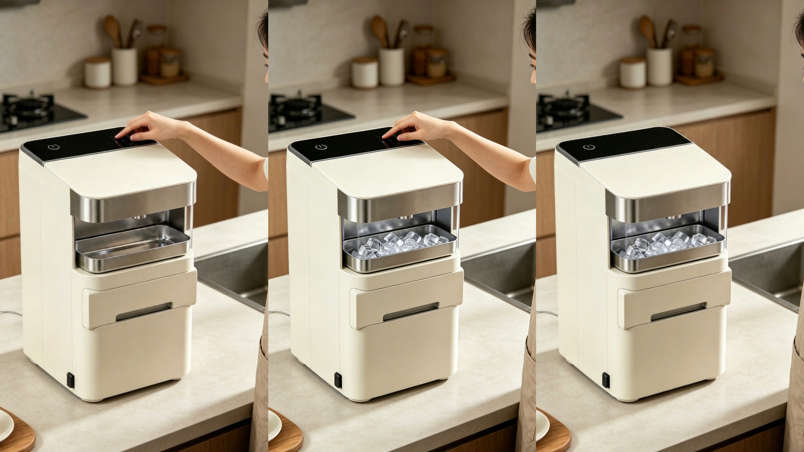
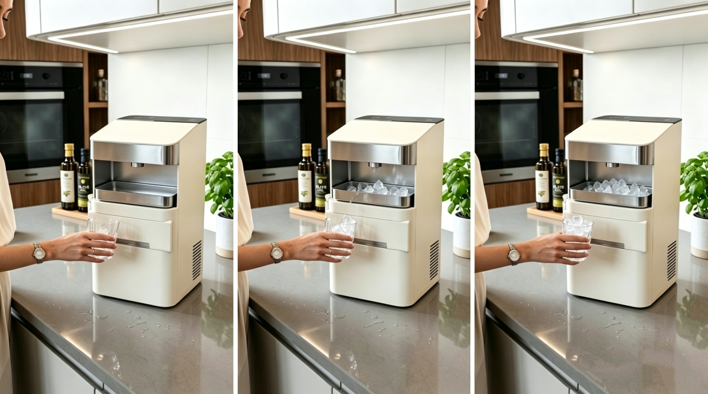

# 敲敲冰 Tap & Chill

> 实验基础课程项目 · B4 组 · 2026 春季学期 · 广州美术学院湾区创新学院
> 成员：袁宁、陈森培、黄若涵、卢筠言、潘梦飞

**融合「敲木鱼」与制冰机的新型赛博玩具**：敲一下，凉一夏；不看手机，不回信息；冰爽在手，烦恼没有。

在制冰功能之上叠加情绪价值——用户开始制冰后，敲木鱼游戏自动启动（舵机落锤 + 蜂鸣器 + OLED「功德 +N」），把等冰的时间变成解压时刻。

> 本项目与同团队在产品结构课的早期方案「冰之世界」一脉相承（用户研究 / 双模制冰 / UV 消毒的产品定义在此完成），本仓为**实验基础课的智能化落地版**。前期方案见 [ice-maker-design](https://github.com/CodyNing-desi/ice-maker-design)。

## 技术架构（4.26 技术说明展板）

| 层 | 组成 |
|----|------|
| 交互层 | 语音唤醒（"你好小智"）+ 敲击传感器（敲木鱼）+ 顶部触控 + OLED 屏 |
| 感知层 | 红外接近 + 超声波（**两次靠近确认**防误触）、水位开关、冰满拨杆、NTC 蒸发器温度 |
| 控制层 | ESP32 主控；小智 AI 云端（ASR → 意图识别 → MCP 工具调用）|
| 执行层 | 压缩机 + 冷凝风扇（制冷）、水泵（上水）、热旁通阀（脱模）、舵机（敲木鱼）、UV 灯（水箱消毒）、蜂鸣器 |

### 场景一：用户回家

手机连上 WiFi → 同步给小智 → 红外/超声波检测靠近 → **第一次靠近仅记录，第二次靠近才触发**（防误触）→ 小智 TTS「来杯冰吗」→ 确认后开始制冰 → 敲木鱼游戏自动启动。

### 场景二：语音直控

语音「我要出冰块」→ 小智云端 ASR + 意图识别 → MCP 工具调用 `start_ice_making()` → `command_router()` → `enter_ice_make_mode()` → 上水 → 制冷 → 热阀脱模 → TTS「出冰了」。

## 控制固件

[`firmware/tap_chill.ino`](firmware/tap_chill.ino) —— ESP32 Arduino 固件，功能名与上方展板一致：

- 制冰状态机：待机 → 上水 → 制冷（NTC 达标或超时封顶）→ 热阀脱模 → 完成
- 敲木鱼游戏：敲击去抖 → 舵机落锤 + 木鱼音 + OLED 功德计数，制冰期间自动开启
- 两次靠近确认（8 秒窗口）、缺水 / 冰满保护、压缩机 3 分钟重启延时、UV 定时消毒
- 语音入口函数 `start_ice_making()` / `command_router()` 预留小智 MCP 工具回调

> 注：当前为补写版（原版代码找回中），可直接编译烧录验证；引脚与时序参数烧真机前需按实际接线标定。

## 完整物料

4.16 结课展板 PDF（31MB）见本仓库 **GitHub Releases**。
